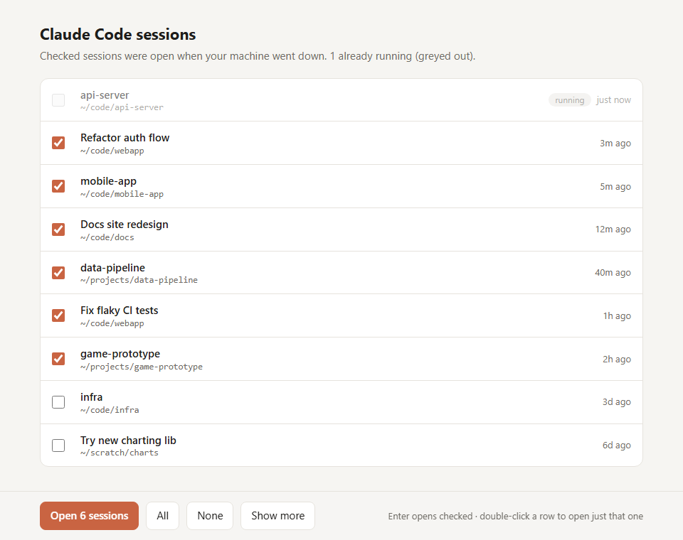

# cc-session-restore

Reopen all your [Claude Code](https://claude.com/claude-code) sessions after a restart, in one click.

If you keep several Claude Code sessions open, a reboot means opening a terminal for each one, `cd`-ing into each project and running `claude --resume`, over and over. This tool lists your recent sessions, pre-checks the ones that were open when the machine went down, and reopens them all as terminal tabs.

<picture>
  <source media="(prefers-color-scheme: dark)" srcset="docs/screenshot-dark.png">
  
</picture>

> **Unofficial.** This is a community tool, not made by or affiliated with Anthropic.

Works on **macOS**, **Linux**, **Windows**, and **WSL** (Claude Code in WSL, opened in Windows Terminal). It's a single Python 3.8+ file with no dependencies.

## Install

```bash
git clone https://github.com/mitchjablonski/cc-session-restore
cd cc-session-restore
./cc-session-restore --install      # Windows: python cc-session-restore --install
```

Run it with the same Python, on the same side (Windows or WSL), as your Claude Code install. `--install` adds a **Claude Code sessions** launcher:

| Where Claude Code runs | Launcher |
|---|---|
| WSL | Windows Start menu shortcut |
| Windows | Start menu shortcut |
| Linux | App menu entry (`~/.local/share/applications`) |
| macOS | `~/Applications/Claude Code sessions.command` (drag it to the Dock) |

To have the picker open automatically when you log in, copy that launcher into your startup items. On Windows, that's the `shell:startup` folder.

It's also handy on your PATH: `ln -s "$PWD/cc-session-restore" ~/.local/bin/`

## Use

Open **Claude Code sessions**, or run `cc-session-restore --gui`. A page opens in your browser:

- **Checked** sessions were open when the machine went down. Click **Open** (or press Enter) to reopen them, each in its own terminal tab.
- **Greyed-out** sessions are already running, so they can't be opened twice.
- Click a row to toggle it. **Double-click** a row to open just that one session.

The page is served on `127.0.0.1` only, behind a random token. It shuts down after you open sessions, or after 15 minutes idle.

### In the terminal

```bash
cc-session-restore              # interactive picker
cc-session-restore list         # just print the list
cc-session-restore -y           # reopen the pre-checked sessions, no questions
cc-session-restore -n 30        # show more sessions
cc-session-restore --dry-run    # print the commands instead of running them
```

### Terminals

Sessions open in the first match:

| Platform | Terminal |
|---|---|
| WSL | Windows Terminal tab running `wsl.exe` |
| Windows | Windows Terminal tab, else a new console window |
| Inside tmux | new tmux window |
| macOS | iTerm2 if you use it or have it installed, else Terminal.app |
| Linux | the terminal you're in (WezTerm, kitty, Konsole, GNOME Terminal), else the first installed of gnome-terminal, konsole, xfce4-terminal, kitty, wezterm, alacritty, x-terminal-emulator, xterm |

To pick one yourself, use `--terminal NAME` or set `CC_SESSION_RESTORE_TERMINAL`. Run `--help` for the full list of names.

### Settings

| Environment variable | What it does |
|---|---|
| `CC_SESSION_RESTORE_TERMINAL` | terminal to open sessions in |
| `CC_SESSION_RESTORE_CLAUDE_ARGS` | extra flags for every resumed session, e.g. `--model opus` |
| `CC_SESSION_RESTORE_CLAUDE_BIN` | command to run instead of `claude` |
| `CLAUDE_CONFIG_DIR` | Claude Code's config folder, if not `~/.claude` |

## How it works

It only reads files Claude Code already keeps on your machine. Nothing is sent anywhere, and nothing is modified.

- **Which sessions exist, and when you last used them:** each session's transcript, `~/.claude/projects/<project>/<session-id>.jsonl`. Its folder, title and file time tell the tool where the session ran and how recently.
- **Which ones were open when the machine went down:** while a session runs, Claude Code keeps `~/.claude/sessions/<pid>.json`. A restart kills the process but leaves the file, so a leftover file with no live process means *this was open*. Leftovers more than a few days older than the newest one, from earlier crashes, aren't pre-checked.
- **Reopening:** each session runs `claude --resume <session-id>` in its original folder, in a new terminal tab.

Only sessions you started yourself in a terminal are listed. SDK and background runs, and sessions whose folder no longer exists, are skipped.

## Caveats

- **This depends on Claude Code's internal files.** The session registry and transcript layout aren't a public API and may change in any release. If the list comes up empty or wrong after a Claude Code update, please open an issue.
- **Pre-checking is a best guess.** A session that was closed normally may still have left its registry file behind. Uncheck anything you don't want.
- **Not every platform is tested yet.** WSL + Windows Terminal and tmux are tested. The macOS, native Windows and other Linux terminal launchers are built from each terminal's documented command line but haven't been run on real machines yet. Reports and fixes are welcome.

## License

MIT
