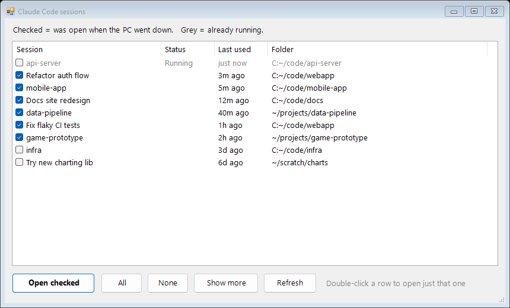

# cc-session-restore

Reopen all your [Claude Code](https://claude.com/claude-code) sessions after a Windows restart, in one click.

If you run several Claude Code sessions in WSL, a reboot (hello, Windows Update) means opening a terminal tab for each one, `cd`-ing into each project and running `claude --resume`, over and over. This tool shows you your recent sessions, pre-checks the ones that were open when the PC went down, and reopens them all as Windows Terminal tabs.



> **Unofficial.** This is a community tool, not made by or affiliated with Anthropic.

## Requirements

- Windows 10/11 with **WSL**, and Claude Code installed **inside WSL**
- **Windows Terminal** (`wt.exe`)
- **python3** in your WSL distro (preinstalled on Ubuntu)

## Install

Clone or download this repo anywhere, then run the installer from PowerShell:

```powershell
git clone https://github.com/mitchjablonski/cc-session-restore
cd cc-session-restore
powershell -ExecutionPolicy Bypass -File .\install.ps1
```

This adds a **Claude Code sessions** shortcut to your Start menu. Options:

```powershell
.\install.ps1 -Desktop          # also put a shortcut on the desktop
.\install.ps1 -Startup          # also open the window automatically when you log in
.\install.ps1 -Distro Debian    # Claude Code is in a WSL distro other than your default
.\install.ps1 -Uninstall        # remove the shortcuts
```

Run the installer from the folder you'll keep the repo in. The shortcut points there.

## Use

Open **Claude Code sessions** from the Start menu.

- **Checked** sessions were open when the PC went down. Press **Open checked** (or Enter) to reopen them, each in its own Windows Terminal tab.
- **Grey** sessions are already running, so they can't be opened twice.
- **Double-click** a row to open just that session.
- **Show more** lists older sessions.

### From a terminal

There's also a text version, which is the same Python script the window uses:

```bash
./cc-session-restore            # interactive picker
./cc-session-restore list       # just print the list
./cc-session-restore -y         # reopen the pre-checked sessions, no questions
./cc-session-restore -n 30      # show more sessions
./cc-session-restore --dry-run  # print the commands instead of running them
```

From Windows, `cc-session-restore.cmd` runs the text version.

To pass extra flags to every resumed session, set `CC_SESSION_RESTORE_CLAUDE_ARGS` in WSL, e.g. `export CC_SESSION_RESTORE_CLAUDE_ARGS="--model opus"`.

## How it works

It only reads files Claude Code already keeps on your machine. Nothing is sent anywhere, and nothing is modified.

- **Which sessions exist and when you last used them:** each session's transcript, `~/.claude/projects/<project>/<session-id>.jsonl`. Its folder, title and file time tell the tool where the session ran and how recently.
- **Which ones were open when the PC went down:** while a session runs, Claude Code keeps `~/.claude/sessions/<pid>.json`. A restart kills the process but leaves the file behind, so a leftover file with no live process means *this was open*. Leftovers older than a few days, from earlier crashes, aren't pre-checked.
- **Opening:** each session opens with
  `wt.exe -w claude new-tab wsl.exe --cd <folder> -- bash -lic "claude --resume <session-id>"`.

Only sessions you started yourself in a terminal are listed. SDK and background runs, and sessions whose folder no longer exists, are skipped.

## Caveats

- **This depends on Claude Code's internal files.** The session registry and transcript layout aren't a public API and may change in any release. If the list comes up empty or wrong after a Claude Code update, please open an issue.
- **Windows + WSL only.** Native Windows, macOS and Linux installs of Claude Code aren't supported (yet).
- **Pre-checking is a best guess.** If a session was closed normally, Claude Code may still have left its registry file behind. Uncheck anything you don't want.

## License

MIT
